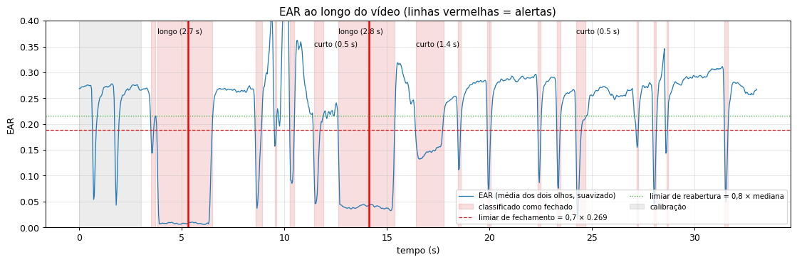
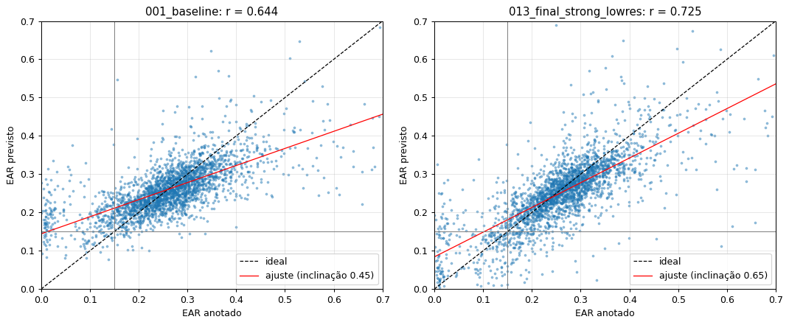
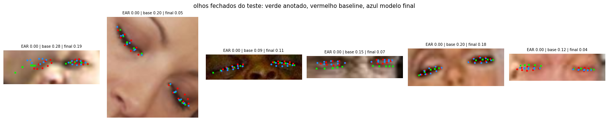
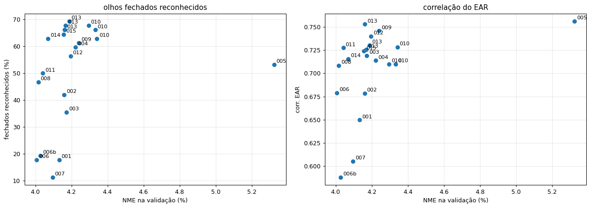
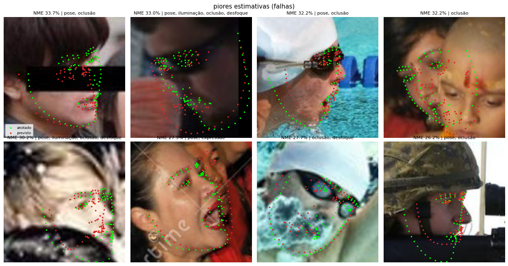

<div align="center">

# Drowsiness Detection with Facial Landmarks

**98-point facial landmark detection trained on WFLW, applied to real-time drowsiness detection through the Eye Aspect Ratio**

[](environment.yml)
[](https://pytorch.org/)
[](https://huggingface.co/arthursilvadantas/drowsiness-detection-landmarks)
[](https://huggingface.co/spaces/arthursilvadantas/drowsiness-detection-demo)
[](https://wywu.github.io/projects/LAB/WFLW.html)

[Live demo](https://huggingface.co/spaces/arthursilvadantas/drowsiness-detection-demo) · [Notebooks](notebooks/) · [Experiments](configs/) · [Model](https://huggingface.co/arthursilvadantas/drowsiness-detection-landmarks)

</div>

## Overview

This project builds a facial landmark detector from a pretrained backbone and a landmark head trained
from scratch, and uses it to watch a driver's eyes on video. The model predicts the **98 WFLW
landmarks** of each face; the eye landmarks give the **Eye Aspect Ratio (EAR)**, and a small state
machine over time tells normal blinks from prolonged eye closures, which trigger a drowsiness alert.

```
camera ─► face detection (YuNet) ─► square crop ─► landmark model (98 points, flip TTA)
       ─► EAR of both eyes ─► calibration + hysteresis ─► blink / short / long closure ─► alert
```

## Results



*EAR (mean of both eyes) over a 33 s webcam video. The threshold is 0.7 × the median EAR of the first
3 s. Both scripted long closures (red lines) raise the alert; blinks and the head turn at 9 to 11 s
do not.*

**Landmarks** on the official WFLW test set (2,500 faces), with flip test-time augmentation. NME is
normalized by the outer eye corners (points 60 and 72); a face fails when its NME is above 10%.

| Model | NME | Failure rate | Eye NME | EAR correlation | Closed eyes detected |
|---|:---:|:---:|:---:|:---:|:---:|
| Baseline (ResNet-18 + deconv head + soft-argmax) | **5.05%** | **6.08%** | 3.53% | 0.644 | 23.4% |
| **Final model** (+ closed-eye oversampling, eye loss weight, low-res augmentation) | 5.12% | 6.68% | **3.27%** | **0.725** | **67.5%** |

*Closed eyes detected: share of the 274 test faces with annotated EAR below 0.15 whose predicted EAR
is also below 0.15. The price: 5.2% of the non-closed eyes are flagged as closed, against 1.0% for the baseline.*

**Full pipeline** (YuNet + crop + model, end to end): 97.8% of the faces
detected, 5.08% NME, 3.14% eye NME, about 150 ms per image on a laptop CPU.

| Annotated vs. predicted EAR (test) | Closed eyes: annotated, baseline, final |
|:---:|:---:|
|  |  |
| The baseline pulls the EAR towards an average open eye | The final model closes the eyelids |
| **Overall precision vs. closed eyes (validation)** | **Hardest test faces** |
|  |  |
| Every variant and extra seed; the eye-focused ones move up | Extreme profiles and occlusions |

- The baseline already places the points well, but it **draws an average open eye**: closed eyes
  (annotated EAR 0.08) come out around 0.19, because only about 9% of the training faces have
  closed eyes and the L1 loss barely notices a 1 to 2 pixel error between the eyelids.
- **Oversampling closed eyes and weighting the eye points** fix most of it. Heatmap regularization
  improves overall precision but not closed eyes; an eyelid-opening loss helps the EAR but, with a
  large weight, hurts the point positions; Wing loss does not help.
- The gain over the baseline is robust across seeds. Among the eye-focused variants, the closed-eye
  rates overlap (63 to 69% over three seeds each); training for 80 instead of 40 epochs is what
  consistently lowers the overall NME (4.32 ± 0.02% to 4.17 ± 0.01% on validation).
- On a webcam, the final model's EAR goes from 0.27 (open) to about 0.01 to 0.04 (closed, also with
  the head turned); the baseline only reaches 0.12 to 0.18, right at the threshold.

## Methodology

| | |
|---|---|
| **Data split** | official `train` split, 90/10 **by image** (6,737 / 763 faces); official `test` (2,500) for final reporting only |
| **Crop** | square with the face box center, side = 1.25 × the longest box side, resized to 256 × 256; YuNet boxes follow the same convention |
| **Augmentation** | horizontal flip with `Mirror98` reordering, rotation ±15°, scale 0.85 to 1.2, translation 6%, brightness and contrast, low-resolution (downscale 2 to 4× and back) |
| **Model** | ResNet-18 (ImageNet) without pooling and FC, 3 transposed convolutions to 64 × 64 heatmaps, soft-argmax for sub-pixel coordinates (15.4M parameters) |
| **Loss** | L1 on the decoded coordinates (no all-zero heatmap trap), eye points 60 to 75 weighted ×8 |
| **Closed eyes** | `WeightedRandomSampler`: faces with annotated EAR below 0.15 sampled 8× more often |
| **Training** | AdamW, lr 1e-3 for the head and 2e-4 for the backbone, 1 warmup epoch and cosine decay, batch 32, 80 epochs, seed 42, RTX A6000 (under 30 min) |
| **Model selection** | validation only: among variants within 0.2 pt of the baseline NME, the one that detects the most closed eyes; the test set never influenced any choice |
| **Inference** | mean of the prediction and the un-mirrored prediction of the flipped face (flip TTA) |
| **Application** | EAR6 averaged over both eyes; threshold 0.7 × median EAR of the first 3 s, reopen at 0.8 ×; 3-frame moving average; blink ≤ 0.4 s, alert from 1.5 s |

## Getting started

Try it without installing anything in the [live demo](https://huggingface.co/spaces/arthursilvadantas/drowsiness-detection-demo):
the webcam tab runs the model in the browser (ONNX Runtime Web), and the video tab analyzes an uploaded video.

```bash
git clone https://github.com/ArthurSilvaDantas/drowsiness-detection-landmarks
cd drowsiness-detection-landmarks
conda env create -f environment.yml && conda activate tpi
pip install -r requirements.txt

# WFLW images and annotations (public Kaggle mirror, no login needed)
python -c "import kagglehub; kagglehub.dataset_download('mrriandmstique/wflw-wider-facial-landmarks-in-the-wild', output_dir='data')"
```

Download the final weights from the [Hugging Face Hub](https://huggingface.co/arthursilvadantas/drowsiness-detection-landmarks)
into `weights/modelo.pt`, or train them (one command, every hyper-parameter in the config file):

```bash
python train.py --data data --config configs/013_final_strong_lowres.yaml --out runs/final
cp runs/final/best.pt weights/modelo.pt
```

Run the application:

```bash
python app.py --source 0                                        # webcam (q to quit)
python app.py --source video.mp4 --out output.mp4 --no-display   # video file
```

Use the model from Python:

```python
from predict import LandmarkModel

model = LandmarkModel("weights/modelo.pt", device="cpu")
landmarks = model.predict(image_rgb)   # (N, 98, 2): one row per detected face, full-image pixels
```

## Notebooks

The notebooks (in Portuguese) are already executed, so all results render on GitHub. Run them in
order: each one uses what the previous one produced.

| # | Notebook | Content |
|---|---|---|
| 1 | [Data exploration](notebooks/01_exploracao_dados.ipynb) | annotation format, the 98 points, attributes, EAR and closed eyes |
| 2 | [Preprocessing](notebooks/02_preprocessamento.ipynb) | crop and its inverse, margin, eye resolution, split, augmentation with `Mirror98`, crop cache |
| 3 | [Model](notebooks/03_modelo.ipynb) | architecture, parameter count, soft-argmax, loss and the all-zero heatmap trap |
| 4 | [Training](notebooks/04_treino.ipynb) | dataset, optimizer, learning-rate schedule, training loop of the baseline |
| 5 | [Baseline evaluation](notebooks/05_avaliacao.ipynb) | NME, failures, subsets, regions, EAR, closed eyes, examples and the YuNet pipeline |
| 6 | [Closed eyes](notebooks/06_olhos_fechados.ipynb) | 15 variants, ROC of open vs. closed, seeds and ablation, model selection |
| 7 | [Final evaluation](notebooks/07_avaliacao_final.ipynb) | the selected model on the test set and through the full pipeline |
| 8 | [Video application](notebooks/08_aplicacao_video.ipynb) | EAR choice, calibration, threshold, hysteresis, blink vs. closure, parameter sensitivity |

## Limitations

- Fewer closed eyes are missed, at the cost of a few more open eyes flagged as closed and a slightly
  higher overall NME (+0.07 pt) than the baseline.
- The EAR also drops when looking down, smiling or squinting; the per-person calibration helps, but
  can not tell these apart from sleepiness.
- The application parameters were checked on a single person's webcam video.
- Trained only on WFLW photos; night or infrared images may behave differently.

## Repository structure

```
├── notebooks/        executed notebooks, one per stage (in Portuguese)
├── train.py          training with a single command
├── predict.py        LandmarkModel: RGB image ─► (N, 98, 2)
├── app.py            video application (webcam or file)
├── utils.py          shared code: data, crop, augmentation, model, loss, metrics, YuNet
├── configs/          hyper-parameters of every experiment (001 to 015)
├── models/           YuNet face detector (OpenCV Zoo)
├── figures/          figures used in this README
├── reports/          experiment reports (in Portuguese)
└── tests/            tests for the crop, flip and metrics
```

## License

The WFLW dataset is for non-commercial research use, and the trained weights follow the same
restriction (CC BY-NC 4.0). WFLW: Wu et al., *Look at Boundary: A Boundary-Aware Face Alignment
Algorithm*, CVPR 2018. EAR: Soukupová and Čech, *Real-Time Eye Blink Detection using Facial
Landmarks*, CVWW 2016. YuNet: [OpenCV Zoo](https://github.com/opencv/opencv_zoo), MIT License.
